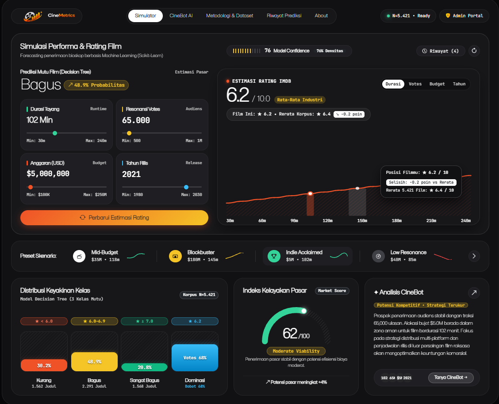
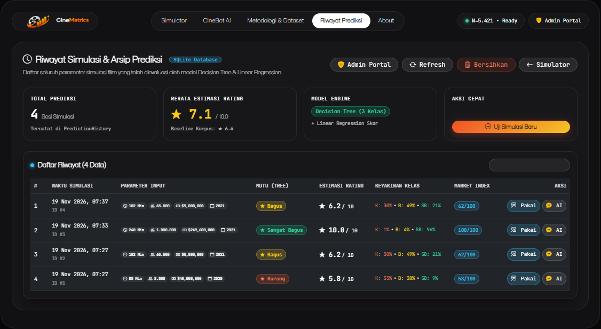
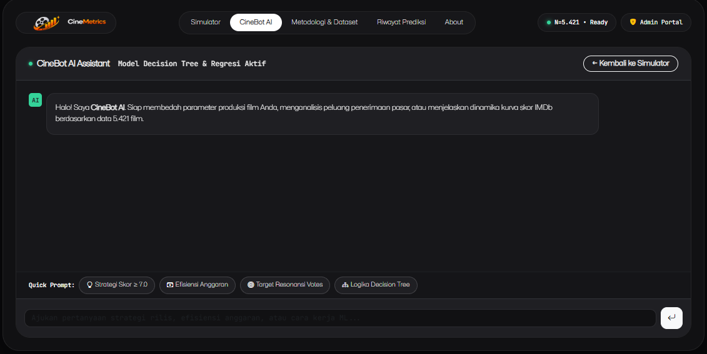

# CineMetrics: Sistem Cerdas Penaksir Kualitas & Rating Film Berbasis Web

> **Implementasi Modul 14 (Deployment Model Machine Learning) & Praktikum P07**   
> **Pengembang:** Mohammad Saputra Abdul Farid (NIM: 253307025)

---

## 1. Tentang Aplikasi

**CineMetrics** adalah aplikasi web interaktif yang berfungsi seperti **"kalkulator pintar" untuk industri film**.

Sebelum sebuah film diproduksi, produser dan sutradara biasanya harus menginvestasikan dana puluhan miliar rupiah tanpa tahu pasti bagaimana respons penonton nantinya. Aplikasi ini membantu memberikan gambaran awal:

- Apakah rencana film tersebut berpeluang masuk kategori **Sangat Bagus**, **Bagus**, atau berisiko **Kurang**?
- Kira-kira berapa perkiraan skor rating IMDb (skala 1.0 s.d. 10.0) yang akan diperoleh?

Semua perkiraan ini dihitung secara matematis menggunakan model kecerdasan buatan (_Machine Learning_) yang telah mempelajari pola dari **5.421 film dunia** yang tercatat di basis data historis IMDb.

---

## 2. Screenshots
### Pratinjau Tampilan Antarmuka:

  
_Gambar 1: Halaman simulator interaktif dengan slider durasi, penonton, anggaran, dan kurva proyeksi rating._

  
_Gambar 2: Tabel riwayat simulasi yang tersimpan otomatis di dalam database SQLite._

  
_Gambar 3: Asisten percakapan cerdas untuk konsultasi parameter film dan strategi box office._

---

## 3. Cara Kerja Sistem

Bagaimana cara komputer belajar menebak film? Berikut alur kerjanya yang dibagi menjadi 4 tahap:

```
[ 1. Data Historis Film ]
   - Mengambil 5.421 data film nyata dari IMDb (durasi, jumlah vote, budget, tahun, rating).
   - Data dibersihkan dari nilai kosong agar akurat.
            │
            ▼
[ 2. Pelatihan 2 Model Cerdas (Machine Learning) ]
   - Model A (Pohon Keputusan / Decision Tree):
     Menebak mutu film (Kurang, Bagus, atau Sangat Bagus).
   - Model B (Regresi Linear):
     Menebak angka nilai IMDb (misalnya 6.8 / 10).
            │
            ▼
[ 3. Penyimpanan Model (Serialisasi Joblib) ]
   - Model yang sudah pintar "dibekukan" ke dalam file biner (.joblib).
   - Tujuannya agar web bisa langsung memakainya tanpa perlu melatih ulang dari awal.
            │
            ▼
[ 4. Aplikasi Web (Django & Bootstrap 5) ]
   - Pengguna menggeser slider (Durasi, Votes, Anggaran, Tahun).
   - Web memanggil model dan menampilkan hasil prediksi + saran strategi dalam hitungan milidetik.
```

### Penjelasan 2 Model yang Dipakai:

1. **Pohon Keputusan (_Decision Tree Classifier_):**
   Cara kerjanya mirip bagan alur tanya-jawab. Model mengecek: _"Apakah jumlah votes penonton di atas batas tertentu? Jika ya, apakah durasinya cukup proporsional?"_. Berdasarkan aturan bertingkat tersebut, film dikelompokkan ke dalam kategori Kurang (< 6.0), Bagus (6.0 - 6.9), atau Sangat Bagus (≥ 7.0).
2. **Regresi Linear (_Linear Regression_):**
   Model ini mencari garis tren hubungan antara durasi dan volume vote terhadap angka rating. Hasilnya berupa perkiraan nilai desimal yang presisi (contoh: 6.7 / 10.0).

---

## 4. Fitur Utama Aplikasi

1. **Simulator Interaktif (What-If Analysis):** Pengguna bisa bereksperimen mengubah-ubah slider durasi tayang, perkiraan jumlah ulasan, anggaran modal, dan tahun rilis untuk melihat pengaruhnya secara langsung.
2. **Grafik Kurva Dinamis & Gauge Pasar:** Menampilkan visualisasi posisi film terhadap rata-rata industri bioskop serta Indeks Kelayakan Pasar (_Market Viability Score_).
3. **Penyimpanan Riwayat Prediksi Otomatis:** Setiap kali simulasi dijalankan, data otomatis tersimpan ke database lokal SQLite dan dapat dilihat kembali, dipulihkan (_restore parameter_), atau dibersihkan.
4. **Asisten AI Percakapan (CineBot):** Asisten pintar terintegrasi Google Gemini yang dapat diajak berdiskusi tentang strategi perfilman. Jika sedang tanpa koneksi internet atau tanpa API key, sistem otomatis beralih ke _Smart Rule-Based Engine_ internal sehingga tetap dapat menjawab pertanyaan seputar model.
5. **Portal Database Admin:** Dilengkapi akses ke Django Admin bawaan untuk mengelola seluruh data arsip simulasi secara resmi.
   - **Alamat URL Admin:** `http://127.0.0.1:8000/admin/`
   - **Username:** `admin`
   - **Password:** `admin123`  
   *(Akun admin ini otomatis dibuat saat migrasi database dijalankan).*

---

## 5. Cara Menjalankan Aplikasi di Komputer Lokal
### Prasyarat Dasar:

- Komputer sudah terpasang **Python** (versi 3.10, 3.11, atau 3.12).

---

### Cara Paling Mudah (Pengguna Windows):

1. **Jalankan Aplikasi Web Django (Versi Lengkap):**
   Cukup klik dua kali file **`run.bat`** di dalam folder proyek.  
   Skrip otomatis akan memeriksa database, melakukan migrasi, dan menyalakan server.  
   Buka browser di alamat: **`http://127.0.0.1:8000/`**

2. **Jalankan Aplikasi Versi Streamlit (Standar Modul 14):**
   Cukup klik dua kali file **`run_streamlit.bat`**.  
   Buka browser di alamat: **`http://localhost:8501/`**

---

### Cara Melalui Terminal (Command Prompt / PowerShell):

Jika Anda lebih nyaman menggunakan baris perintah:

1. **Buka terminal dan masuk ke folder proyek:**

   ```bash
   cd "d:/SEMESTER 3/Tugas Akhir"
   ```

2. **Aktifkan virtual environment (jika ada):**

   ```powershell
   # Di Windows PowerShell:
   .\venv\Scripts\Activate.ps1

   # Atau di Command Prompt biasa:
   .\venv\Scripts\activate.bat
   ```

3. **Pasang paket pustaka yang dibutuhkan:**

   ```bash
   pip install -r requirements.txt
   ```

4. **Siapkan database SQLite:**

   ```bash
   python manage.py migrate
   ```

5. **Nyalakan server web Django:**
   ```bash
   python manage.py runserver
   ```
   Buka browser di: **`http://127.0.0.1:8000/`**

---

## 6. Cara Menjalankan Langsung via Cloud (Tanpa Komputer Lokal)

Jika Anda ingin dosen dapat mencoba aplikasi langsung dari browser tanpa perlu mengunduh file apapun:

### Opsi A: Melalui GitHub Codespaces

1. Buka repositori ini di GitHub: `https://github.com/y9ricd/CineMetrics`.
2. Klik tombol hijau **`<> Code`** > pilih tab **`Codespaces`** > klik **`Create codespace on main`**.
3. Di terminal Codespaces yang muncul di browser, ketik:
   ```bash
   pip install -r requirements.txt
   python manage.py migrate
   python manage.py runserver 0.0.0.0:8000
   ```
4. Klik tombol notifikasi **Open in Browser** yang muncul di sudut kanan bawah.

### Opsi B: Melalui Streamlit Community Cloud (Aktif 24 Jam)

1. Hubungkan repositori `y9ricd/CineMetrics` ke platform gratis [Streamlit Share](https://share.streamlit.io).
2. Tentukan file utama: `app.py`.
3. Aplikasi akan aktif online dan dapat diakses dari laptop maupun handphone melalui tautan publik.

---

## 7. Susunan Berkas & Struktur Folder Proyek

Untuk memudahkan dosen dan penilai melihat struktur pekerjaan:

```text
Tugas Akhir/
├── manage.py                     # Perintah utama manajemen Django
├── requirements.txt              # Daftar pustaka Python yang dipakai
├── README.md                     # Buku panduan & dokumentasi resmi ini
├── run.bat / run.ps1             # Skrip otomatis 1-klik untuk menjalankan Django
├── run_streamlit.bat / .ps1      # Skrip otomatis 1-klik untuk menjalankan Streamlit
├── app.py                        # Implementasi antarmuka Streamlit (Standar Modul 14)
├── db.sqlite3                    # Database lokal penyimpan riwayat prediksi
│
├── ml_model/                     # Bagian Khusus Machine Learning
│   ├── movies_clean.csv          # Dataset film hasil pembersihan (5.421 data)
│   ├── train_and_export.py       # Program untuk melatih & mengekspor model
│   ├── model_quality.joblib      # File biner model Decision Tree
│   ├── model_score.joblib        # File biner model Linear Regression
│   └── model_meta.json           # Rangkuman statistik dan bobot pengaruh fitur
│
├── movie_system/                 # Pengaturan Induk Django
│   ├── settings.py               # Konfigurasi keamanan, database, dan logging
│   └── urls.py                   # Pintu gerbang alamat URL web
│
└── predictor/                    # Aplikasi Utama Penaksir Film
    ├── models.py                 # Struktur tabel database (PredictionHistory)
    ├── forms.py                  # Pengecekan batas angka wajar input pengguna
    ├── views.py                  # Logika pemanggilan model ML dan respons web
    ├── ai_service.py             # Layanan konsultasi CineBot (Gemini AI & Fallback)
    ├── tests.py                  # 13 pengujian otomatis (Unit Testing)
    └── templates/predictor/
        ├── base.html             # Kerangka halaman web utama
        └── index.html            # Desain antarmuka dashboard Bento visual
```

---

## 8. Verifikasi & Pengujian Otomatis (Unit Testing)

Untuk memastikan tidak ada rumus yang salah dan sistem tidak mengalami _error_ saat digunakan, telah dibuat **13 skenario pengujian unit otomatis**.

Jalankan perintah ini di terminal:

```bash
python manage.py test predictor
```

**Hasil Pengujian:**

```text
Ran 13 tests in 1.414s
OK
System check identified no issues (0 silenced).
```

Seluruh 13 pengujian mencakup: verifikasi pemuatan file biner model, penolakan input angka negatif/tidak masuk akal, kebenaran kalkulasi rating, penyimpanan riwayat ke database, penolakan pertanyaan di luar topik film pada chatbot, dan keabsahan data grafik.


